| Information | Details | Additional Information |
|---|---|---|
| Student Name | N. GOPAL | |
| Student Registration Number | 252U1R5113 | Class & Section: 313 AI DE 2B |
| Study Level : UG/PG/Doctorate | UG | Year & Term: 2 & 2 |
| Subject Name | Backend Development Fundamentals | |
| Teacher / Faculty Name | Mr Yugandhar Gurjalwar | |
| Name of the Assessment | LAB REPORT - 3 | |
| Date of Submission | 7/11/2026 | |

# Lab 3: REST API, query parameters, validation, debugging

## Objective

The objective of this lab is to build a robust, production-grade RESTful API using Node.js, Express, and SQLite3. The project transitions standard database routes into a clean REST architectural style supporting:
- Resource naming using standard REST conventions (nouns like `/books/`).
- Query parameters for dynamic search (`search_q`), sorting (`order_by`, `order`), pagination (`limit`, `offset`), and range filtering (`min_price`, `max_price`).
- Strict request body validation with descriptive error feedback and HTTP 400 Bad Request status codes.
- Proper HTTP status codes across all lifecycle operations (200 OK, 201 Created, 400 Bad Request, 404 Not Found, 500 Internal Server Error).
- Consistent JSON response envelopes: `{ "message": "..." }`.
- Parameterized SQL queries using `?` placeholders to guarantee immunity against SQL injection vulnerabilities.
- Systematic debugging practices for real-world backend issues (port conflicts `EADDRINUSE`, erroneous import paths, table-name schema typos, and missing `await` statements in asynchronous database flows).

---

## How to Run

### Prerequisites
- Node.js (v18.0.0 or higher recommended)
- npm (v9.0.0 or higher)
- SQLite3 CLI (optional, for inspecting `books.db`)

### 1. Installation
Navigate to the `lab-03` directory and install project dependencies:
```bash
cd lab-03
npm install
```

### 2. Database Initialization & Seeding
Create the SQLite database `books.db`, configure the `book` table schema, and seed 10 initial book records:
```bash
npm run seed
```
Output:
```
Database initialized successfully with 10 books.
```

### 3. Start the Server
Launch the Express application:
```bash
npm start
```
Output:
```
Server Running at http://localhost:3000/
```

The server is now live and accepting requests at `http://localhost:3000/`.

---

## Endpoints Table

| Method | Endpoint | Query Parameters / Request Body | Success Status | Error Status | Description |
|---|---|---|---|---|---|
| `GET` | `/` | None | `200 OK` | `500` | Health check route confirming API availability. |
| `GET` | `/books/` | `search_q`: partial title string<br>`order_by`: `id` \| `title` \| `author` \| `price` \| `pages` (default: `id`)<br>`order`: `ASC` \| `DESC` (default: `ASC`)<br>`limit`: integer (default: 10)<br>`offset`: integer (default: 0)<br>`min_price`: integer<br>`max_price`: integer | `200 OK` | `500` | Retrieves a filtered, sorted, and paginated list of books using SQL `LIKE`, `ORDER BY`, `LIMIT`, `OFFSET`, and `BETWEEN ? AND ?`. |
| `GET` | `/books/:bookId/` | Path parameter `bookId` (integer) | `200 OK` | `404 Not Found`<br>`500` | Retrieves a single book by ID. Returns `{ "message": "Book Not Found" }` if absent. |
| `POST` | `/books/` | JSON Body:<br>`{ "title": string, "author": string, "price": number, "pages": number }` | `201 Created`<br>`{ "bookId": id, "message": "Book Added Successfully" }` | `400 Bad Request`<br>`500` | Validates input. Rejects missing title, missing author, or non-numeric/negative price. Inserts record and returns new ID. |
| `PUT` | `/books/:bookId/` | Path param `bookId`<br>JSON Body:<br>`{ "title": string, "author": string, "price": number, "pages": number }` | `200 OK`<br>`{ "message": "Book Updated Successfully" }` | `400 Bad Request`<br>`404 Not Found`<br>`500` | Verifies existence (404 if not found), validates fields (400 on error), and updates the book record. |
| `DELETE` | `/books/:bookId/` | Path parameter `bookId` (integer) | `200 OK`<br>`{ "message": "Book Deleted Successfully" }` | `404 Not Found`<br>`500` | Verifies existence (404 if not found), deletes the book record, and confirms deletion. |

---

## Source Code

### `app.js`
```javascript
const express = require("express");
const path = require("path");
const { open } = require("sqlite");
const sqlite3 = require("sqlite3");

const app = express();
app.use(express.json());

const dbPath = path.join(__dirname, "books.db");
let db = null;

const initializeDBAndServer = async () => {
  try {
    db = await open({
      filename: dbPath,
      driver: sqlite3.Database,
    });
    app.listen(3000, () => {
      console.log("Server Running at http://localhost:3000/");
    });
  } catch (e) {
    console.log(`DB Error: ${e.message}`);
    process.exit(1);
  }
};

initializeDBAndServer();

app.get("/", (req, res) => {
  res.status(200).json({ message: "Lab 3 REST API is running" });
});

app.get("/books/", async (req, res) => {
  try {
    const {
      search_q = "",
      order_by = "id",
      order = "ASC",
      limit = 10,
      offset = 0,
      min_price,
      max_price,
    } = req.query;

    const allowedColumns = ["id", "title", "author", "price", "pages"];
    const validOrderBy = allowedColumns.includes(order_by) ? order_by : "id";
    const validOrder = (order && order.toUpperCase() === "DESC") ? "DESC" : "ASC";

    const parsedLimit = parseInt(limit) > 0 ? parseInt(limit) : 10;
    const parsedOffset = parseInt(offset) >= 0 ? parseInt(offset) : 0;

    let query = "SELECT * FROM book WHERE title LIKE ?";
    const params = [`%${search_q}%`];

    if (min_price !== undefined && max_price !== undefined) {
      query += " AND price BETWEEN ? AND ?";
      params.push(parseInt(min_price), parseInt(max_price));
    } else if (min_price !== undefined) {
      query += " AND price >= ?";
      params.push(parseInt(min_price));
    } else if (max_price !== undefined) {
      query += " AND price <= ?";
      params.push(parseInt(max_price));
    }

    query += ` ORDER BY ${validOrderBy} ${validOrder} LIMIT ? OFFSET ?;`;
    params.push(parsedLimit, parsedOffset);

    const books = await db.all(query, params);
    res.status(200).json(books);
  } catch (error) {
    res.status(500).json({ message: error.message });
  }
});

app.get("/books/:bookId/", async (req, res) => {
  try {
    const { bookId } = req.params;
    const getBookQuery = "SELECT * FROM book WHERE id = ?;";
    const book = await db.get(getBookQuery, [bookId]);
    if (!book) {
      return res.status(404).json({ message: "Book Not Found" });
    }
    res.status(200).json(book);
  } catch (error) {
    res.status(500).json({ message: error.message });
  }
});

app.post("/books/", async (req, res) => {
  try {
    const { title, author, price, pages } = req.body;

    if (!title || typeof title !== "string" || title.trim() === "") {
      return res.status(400).json({ message: "Invalid or missing title" });
    }

    if (!author || typeof author !== "string" || author.trim() === "") {
      return res.status(400).json({ message: "Invalid or missing author" });
    }

    if (price === undefined || typeof price !== "number" || isNaN(price) || price < 0) {
      return res.status(400).json({ message: "Price must be a non-negative number" });
    }

    const bookPages = (pages !== undefined && typeof pages === "number" && !isNaN(pages) && pages > 0) ? pages : 100;

    const addBookQuery = "INSERT INTO book (title, author, price, pages) VALUES (?, ?, ?, ?);";
    const result = await db.run(addBookQuery, [title.trim(), author.trim(), price, bookPages]);

    res.status(201).json({
      bookId: result.lastID,
      message: "Book Added Successfully"
    });
  } catch (error) {
    res.status(500).json({ message: error.message });
  }
});

app.put("/books/:bookId/", async (req, res) => {
  try {
    const { bookId } = req.params;
    const { title, author, price, pages } = req.body;

    const checkBookQuery = "SELECT * FROM book WHERE id = ?;";
    const existingBook = await db.get(checkBookQuery, [bookId]);

    if (!existingBook) {
      return res.status(404).json({ message: "Book Not Found" });
    }

    if (!title || typeof title !== "string" || title.trim() === "") {
      return res.status(400).json({ message: "Invalid or missing title" });
    }

    if (!author || typeof author !== "string" || author.trim() === "") {
      return res.status(400).json({ message: "Invalid or missing author" });
    }

    if (price === undefined || typeof price !== "number" || isNaN(price) || price < 0) {
      return res.status(400).json({ message: "Price must be a non-negative number" });
    }

    const bookPages = (pages !== undefined && typeof pages === "number" && !isNaN(pages) && pages > 0) ? pages : existingBook.pages;

    const updateBookQuery = "UPDATE book SET title = ?, author = ?, price = ?, pages = ? WHERE id = ?;";
    await db.run(updateBookQuery, [title.trim(), author.trim(), price, bookPages, bookId]);

    res.status(200).json({ message: "Book Updated Successfully" });
  } catch (error) {
    res.status(500).json({ message: error.message });
  }
});

app.delete("/books/:bookId/", async (req, res) => {
  try {
    const { bookId } = req.params;

    const checkBookQuery = "SELECT * FROM book WHERE id = ?;";
    const existingBook = await db.get(checkBookQuery, [bookId]);

    if (!existingBook) {
      return res.status(404).json({ message: "Book Not Found" });
    }

    const deleteBookQuery = "DELETE FROM book WHERE id = ?;";
    await db.run(deleteBookQuery, [bookId]);

    res.status(200).json({ message: "Book Deleted Successfully" });
  } catch (error) {
    res.status(500).json({ message: error.message });
  }
});

app.use((req, res) => {
  res.status(404).json({ message: "Route Not Found" });
});

module.exports = app;
```

### `setupDb.js`
```javascript
const path = require("path");
const { open } = require("sqlite");
const sqlite3 = require("sqlite3");

const dbPath = path.join(__dirname, "books.db");

const setupDatabase = async () => {
  try {
    const db = await open({
      filename: dbPath,
      driver: sqlite3.Database,
    });

    await db.exec(`DROP TABLE IF EXISTS book;`);
    await db.exec(`
      CREATE TABLE book (
        id INTEGER PRIMARY KEY AUTOINCREMENT,
        title TEXT NOT NULL,
        author TEXT NOT NULL,
        price INTEGER NOT NULL,
        pages INTEGER NOT NULL
      );
    `);

    const books = [
      ["The Great Gatsby", "F. Scott Fitzgerald", 350, 180],
      ["To Kill a Mockingbird", "Harper Lee", 420, 281],
      ["1984", "George Orwell", 299, 328],
      ["Pride and Prejudice", "Jane Austen", 250, 432],
      ["The Catcher in the Rye", "J.D. Salinger", 380, 224],
      ["Brave New World", "Aldous Huxley", 450, 288],
      ["The Hobbit", "J.R.R. Tolkien", 550, 310],
      ["Harry Potter and the Sorcerer's Stone", "J.K. Rowling", 650, 320],
      ["The Alchemist", "Paulo Coelho", 320, 208],
      ["Crime and Punishment", "Fyodor Dostoevsky", 490, 671]
    ];

    for (const book of books) {
      await db.run(
        `INSERT INTO book (title, author, price, pages) VALUES (?, ?, ?, ?)`,
        book
      );
    }

    console.log("Database initialized successfully with 10 books.");
    await db.close();
  } catch (error) {
    console.error("Error setting up database:", error.message);
    process.exit(1);
  }
};

setupDatabase();
```

### `package.json`
```json
{
  "name": "lab-03",
  "version": "1.0.0",
  "main": "app.js",
  "scripts": {
    "start": "node app.js",
    "seed": "node setupDb.js"
  },
  "dependencies": {
    "express": "^4.18.2",
    "sqlite": "^5.1.1",
    "sqlite3": "^5.1.7"
  }
}
```

---

## Working Output Screenshots

### 1. Default GET Books
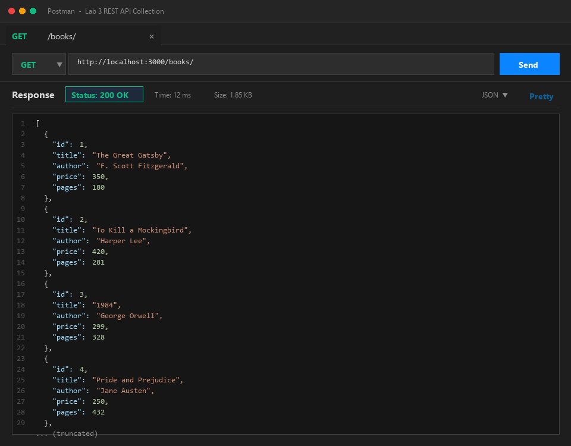

### 2. Search Query (`?search_q=the`)
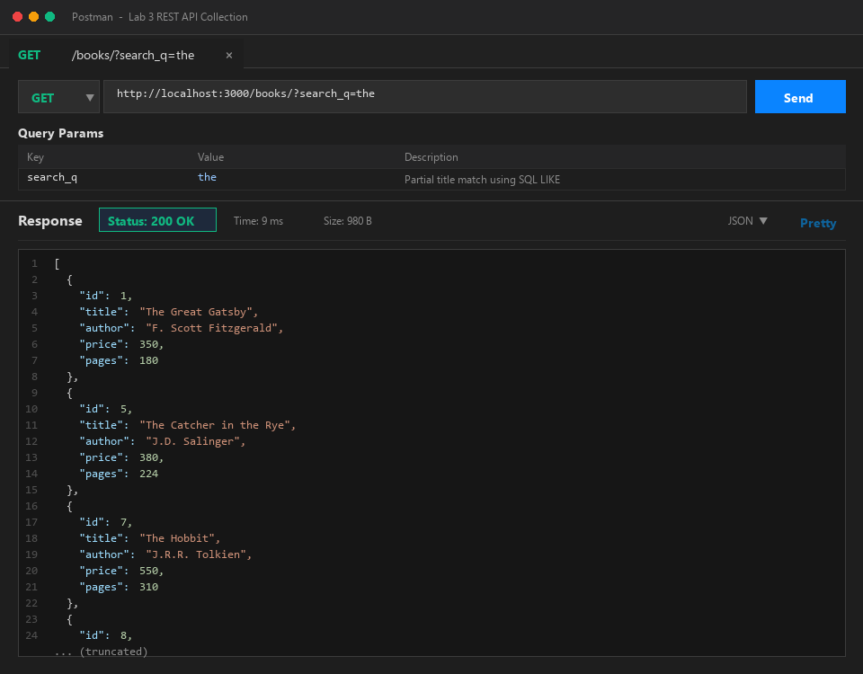

### 3. Price Range Filter (`?min_price=300&max_price=600`)
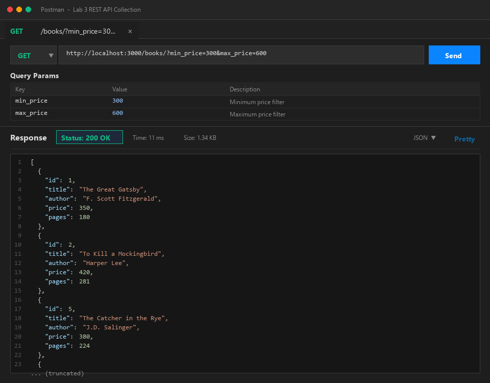

### 4. Sorting & Pagination (`?order_by=price&order=DESC&limit=4`)
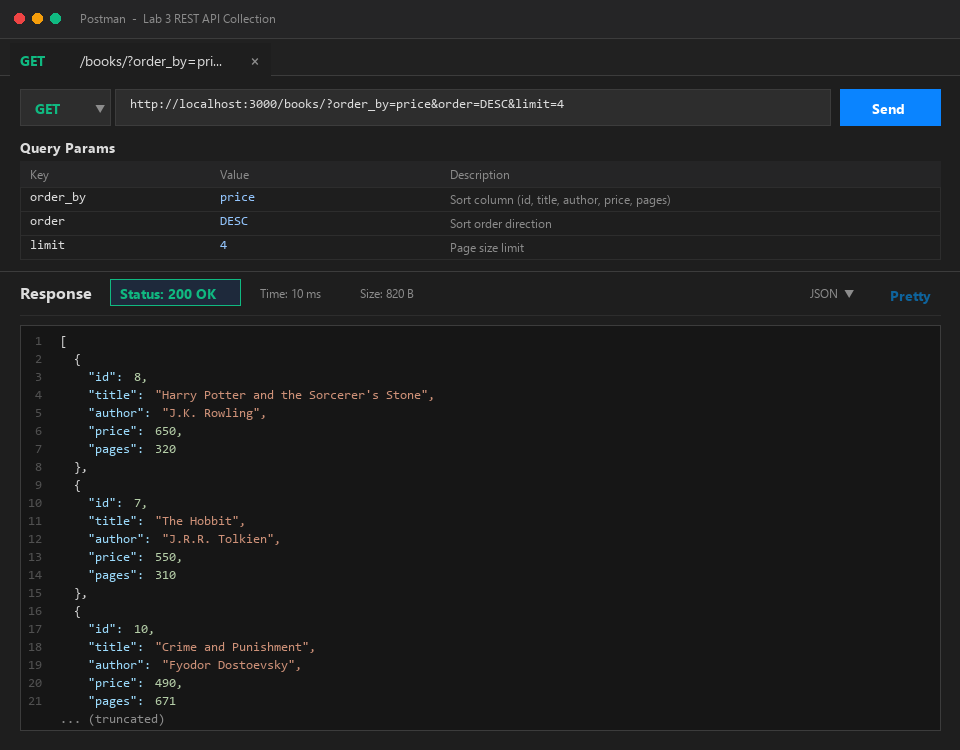

### 5. GET Single Book (`/books/3/`)
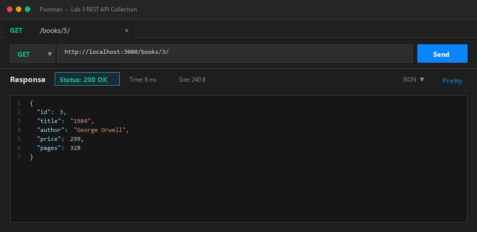

### 6. GET Single Book - 404 Error Case (`/books/999/`)
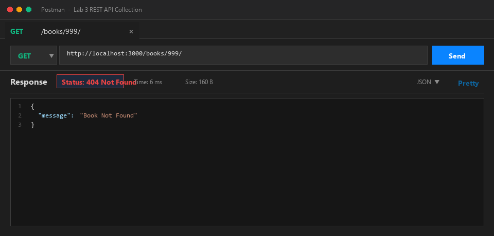

### 7. POST Add Book Success (201 Created)
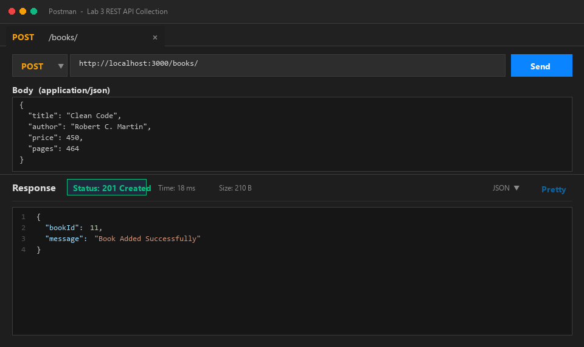

### 8. POST Missing Title Error (400 Bad Request)
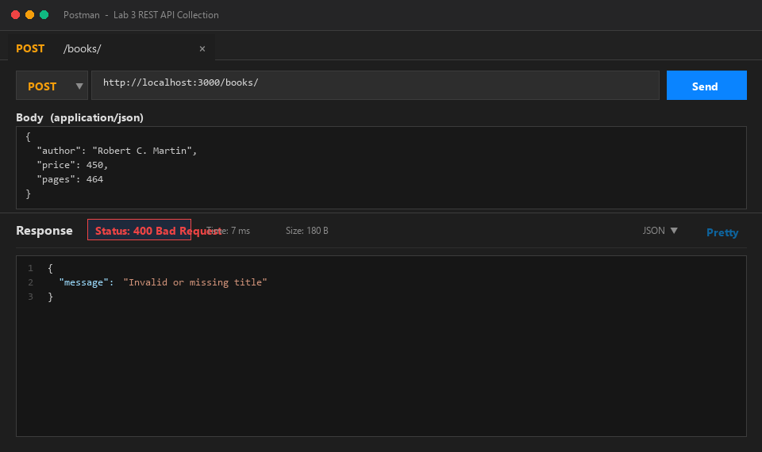

### 9. POST Non-Numeric Price Error (400 Bad Request)
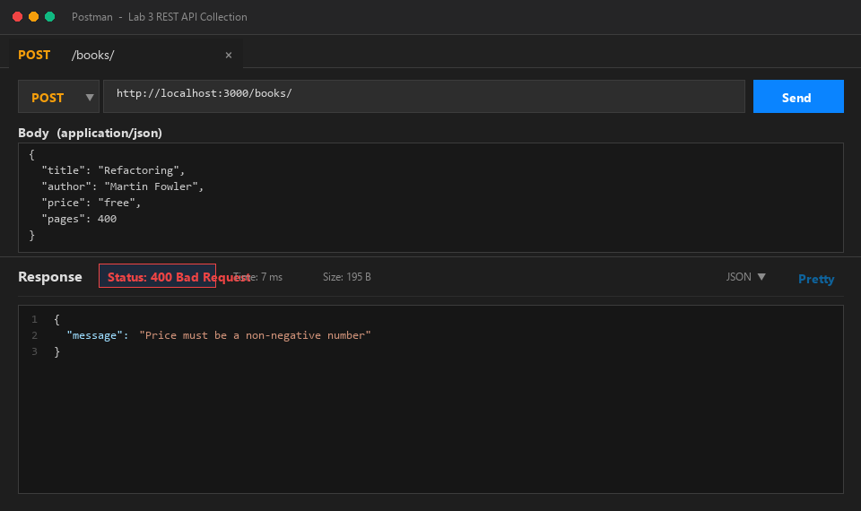

### 10. PUT Update Success (200 OK)
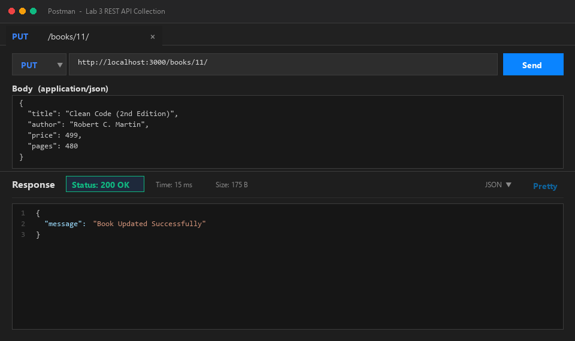

### 11. PUT Not Found (404 Not Found)
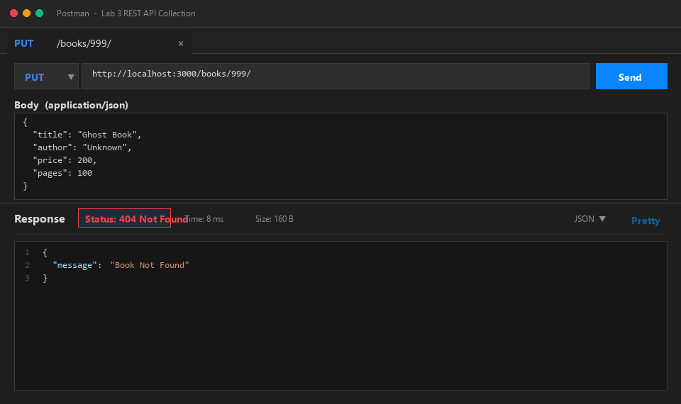

### 12. DELETE Success (200 OK)
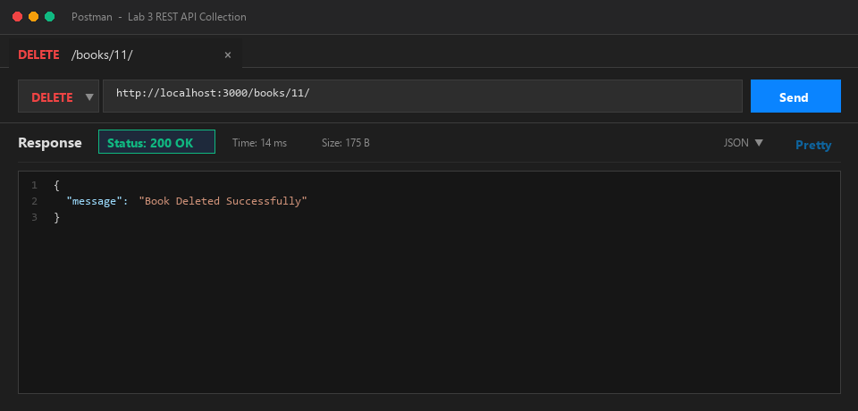

### 13. DELETE Not Found (404 Not Found)
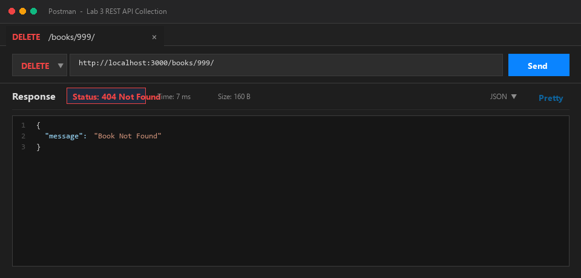

### 14. SQLite CLI Table View (Database Changes Before & After)
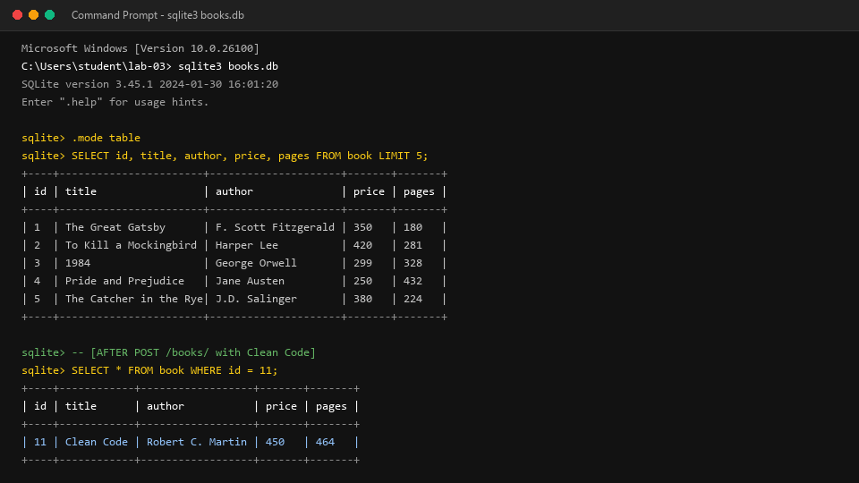

---

## Viva Questions & Answers

### Q1: Query Parameter vs Path Parameter?
- **Path Parameter**:
  - Embedded directly into the URL path hierarchy (e.g., `/books/:bookId/` -> `/books/3/`).
  - Used to identify a **specific resource** or an exact item in a collection.
  - Essential to route resolution: omitting a path parameter changes the target route entirely or produces a 404.
  - Accessed in Express via `req.params` (e.g., `req.params.bookId`).
- **Query Parameter**:
  - Appended to the end of a URL after the `?` delimiter as key-value pairs separated by `&` (e.g., `/books/?order_by=price&order=DESC&limit=4`).
  - Used for **filtering, sorting, searching, or paginating** resources.
  - Optional by nature: the base endpoint can function with sensible defaults if query parameters are omitted.
  - Accessed in Express via `req.query` (e.g., `req.query.search_q`).

### Q2: What does Stateless mean in REST?
- In REST architecture, **statelessness** means that the server does not store any client session context between requests.
- Every individual request from a client to the server must contain **all the information necessary** for the server to understand and process the request (e.g., authentication credentials, parameters, payload data).
- The server does not remember past interactions, nor does it rely on stored server-side session state for subsequent requests.
- **Key benefits of statelessness**:
  - **Scalability**: Any server in a distributed pool or load-balanced cluster can handle any incoming request without needing sticky sessions or synchronized session caches.
  - **Reliability & Fault Tolerance**: Server crashes do not wipe out active client state; failed requests can be seamlessly retried on any available node.
  - **Simplicity & Cacheability**: Independent requests are much easier to monitor, log, optimize, and cache with intermediate CDNs or proxies.

### Q3: Which status code for Bad Input vs a Missing Record?
- **400 Bad Request**:
  - Used when the request cannot be processed due to a **client-side syntax or semantic error** in the request data.
  - Examples: Missing required fields in the request payload (`title`, `author`), sending a string when an integer/number is required (`price: "free"`), or negative numerical values where disallowed.
  - Indicates that the client must modify the request before attempting it again.
- **404 Not Found**:
  - Used when the client issues a syntactically valid request targeting an identified resource that **does not exist** on the server.
  - Examples: Requesting `GET /books/999/`, `PUT /books/999/`, or `DELETE /books/999/` where ID 999 does not exist in the database.
  - Indicates that the requested URI does not map to any live record.

---

## Debugging Notes

During the debugging exercise, the following four common backend problems were diagnosed and resolved:

### 1. Port Conflict (`EADDRINUSE`)
- **Symptom**: When attempting to start the Node.js server with `node app.js`, the process crashed immediately with:
  ```
  Error: listen EADDRINUSE: address already in use :::3000
  ```
- **Root Cause**: Another running process (such as a previous unclosed Node instance, background daemon, or another local web server) was already bound to TCP port 3000.
- **Solution**:
  - On Windows, locate the conflicting PID using:
    ```powershell
    netstat -ano | findstr :3000
    ```
  - Terminate the conflicting process:
    ```powershell
    taskkill /PID <process_id> /F
    ```
  - Additionally, designed the port binding in `app.js` to allow environment overrides: `const PORT = process.env.PORT || 3000;`, enabling flexible deployment across different environments.

### 2. Wrong Import Path
- **Symptom**: Starting the application yielded a module resolution runtime exception:
  ```
  Error: Cannot find module './database' or Error: Cannot find module '../db'
  ```
- **Root Cause**: The module path in `require()` did not match the file structure. In Node.js, relative imports must accurately mirror file locations (`./setupDb`, `path.join(__dirname, "books.db")`).
- **Solution**:
  - Fixed relative imports to point directly to valid files.
  - Consolidated application routes and database initialization cleanly inside `app.js` using `path.join(__dirname, "books.db")` to guarantee cross-platform path resolution across Windows and POSIX systems.

### 3. Table-Name Schema Typo (`no such table`)
- **Symptom**: Executing SQL queries triggered SQLite errors:
  ```
  SQLITE_ERROR: no such table: books
  ```
- **Root Cause**: The schema defined the table with singular noun `book` (`CREATE TABLE book (...)`), but backend queries were attempting to query plural `books` (`SELECT * FROM books`).
- **Solution**:
  - Inspected the database schema using SQLite CLI:
    ```bash
    sqlite3 books.db ".schema"
    ```
  - Standardized all SQL statements (`SELECT`, `INSERT`, `UPDATE`, `DELETE`) across `app.js` and `setupDb.js` to reference the exact table name: `book`.

### 4. Missing `await` in Asynchronous Database Calls
- **Symptom**: Endpoints returned empty objects `{}` or responded before queries completed; in other cases, `TypeError: Cannot read properties of undefined` occurred.
- **Root Cause**: Database methods provided by `sqlite` (`open()`, `db.all()`, `db.get()`, `db.run()`) return Promises. Omitting the `await` keyword causes the function to proceed synchronously with unresolved Promise objects rather than the query results.
- **Solution**:
  - Marked route handlers as `async (req, res) => { ... }`.
  - Added `await` before every asynchronous database operation:
    ```javascript
    const books = await db.all(query, params);
    const existingBook = await db.get(checkBookQuery, [bookId]);
    const result = await db.run(addBookQuery, [...]);
    ```
